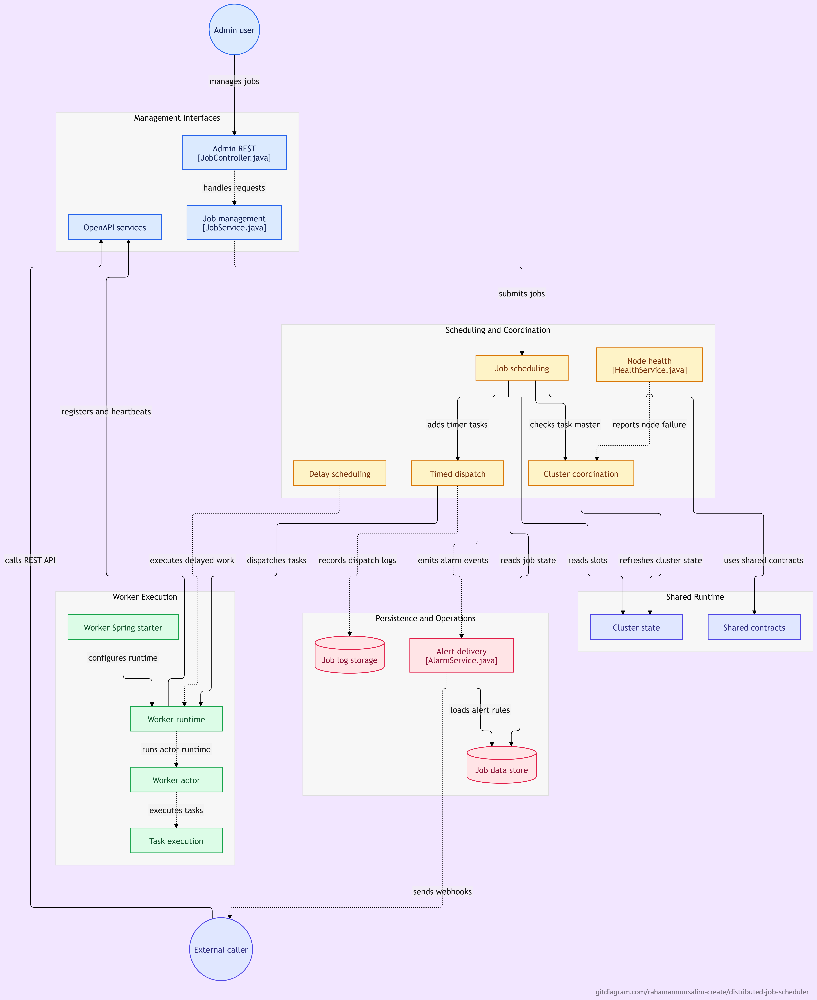

<div align="center">

  <h1>Distributed Job Scheduler</h1>

  <p>
    A production-grade, distributed task scheduling framework built with Java 27 and Spring Boot.
  </p>

  <p>
    <a href="https://github.com/rahamanmursalim-create/Distributed-Job-Scheduler/actions/workflows/maven.yaml">
      
    </a>
    <a href="https://github.com/rahamanmursalim-create/Distributed-Job-Scheduler/actions/workflows/codeql.yml">
      
    </a>
    <a href="LICENSE">
      
    </a>
    <a href="https://openjdk.org/projects/jdk/27/">
      
    </a>
    <a href="https://spring.io/projects/spring-boot">
      
    </a>
  </p>

</div>

---

## Overview

**Distributed Job Scheduler** is a high-availability, horizontally scalable job scheduling system designed for large-scale production environments. It provides a unified platform for managing, executing, and monitoring distributed tasks across multiple nodes.

### Key Features

- **Distributed Coordination** — Cluster-aware task dispatching via Akka actors
- **Multiple Execution Modes** — Standalone, broadcast, sharding, and MapReduce job types
- **Delay Queue** — Redis-backed delay task execution with reliable delivery
- **Admin Dashboard** — Web UI for job management, monitoring, and log inspection
- **OpenAPI** — REST API for external integration
- **Worker SDK** — Spring Boot auto-configuration for seamless worker integration
- **High Availability** — Automatic failover and task re-scheduling on node failure

---

## Architecture

<p align="center">
  
</p>

<p align="center">
  <em>High-level architecture and interaction between scheduling,
  coordination, worker execution, and persistence components.</em>
</p>

---

## Project Modules

| Module | Description |
|--------|-------------|
| `distributed-job-scheduler-common` | Shared constants, utilities, and base classes |
| `distributed-job-scheduler-server` | Server-side parent module |
| `distributed-job-scheduler-server-admin` | Admin REST API and web controller |
| `distributed-job-scheduler-server-cluster` | Cluster management and node coordination |
| `distributed-job-scheduler-server-log` | Job log persistence (Elasticsearch / H2 / MySQL) |
| `distributed-job-scheduler-server-openapi` | Public REST OpenAPI for external callers |
| `distributed-job-scheduler-server-scheduler` | Core scheduling engine (cron, delay, sharding) |
| `distributed-job-scheduler-server-starter` | Spring Boot auto-starter for the server |
| `distributed-job-scheduler-worker` | Worker parent module |
| `distributed-job-scheduler-worker-core` | Worker task execution engine |
| `distributed-job-scheduler-worker-samples` | Example worker implementations |
| `distributed-job-scheduler-worker-spring-boot-starter` | Spring Boot auto-starter for workers |
| `distributed-job-scheduler-ui` | Frontend admin dashboard (Vue.js) |

---

## Technology Stack

| Technology | Version | Purpose |
|-----------|---------|---------|
| Java | 27 | Runtime |
| Spring Boot | 4.1.2 | Application framework |
| Apache Maven | 3.9+ | Build tool |
| Akka | 2.6.x | Distributed actor system |
| Redis | 6+ | Delay queue & distributed locks |
| MySQL | 8+ | Primary data store |
| Elasticsearch | 7.x | Job log storage (optional) |
| H2 | — | Embedded DB for testing |

---

## Getting Started

### Prerequisites

- **JDK 27** — [Download](https://openjdk.org/projects/jdk/27/)
- **Apache Maven 3.9+** — [Download](https://maven.apache.org/)
- **MySQL 8+** (for server)
- **Redis 6+** (for scheduler)

### Build

```bash
# Clone the repository
git clone https://github.com/rahamanmursalim-create/Distributed-Job-Scheduler.git
cd Distributed-Job-Scheduler

# Build all modules
mvn clean install -DskipTests

# Run tests
mvn clean test
```

### Quick Start (Server)

1. Configure `application.yml` in `distributed-job-scheduler-server-starter`:

```yaml
spring:
  datasource:
    url: jdbc:mysql://localhost:3306/distributed_job_scheduler
    username: root
    password: yourpassword
  redis:
    host: localhost
    port: 6379
```

2. Start the server:

```bash
cd distributed-job-scheduler-server/distributed-job-scheduler-server-starter
mvn spring-boot:run
```

3. Access the Admin Dashboard at `http://localhost:7700`

### Worker Integration

Add the worker starter to your Spring Boot app:

```xml
<dependency>
    <groupId>io.distributedjobscheduler</groupId>
    <artifactId>distributed-job-scheduler-worker-spring-boot-starter</artifactId>
    <version>1.0.0</version>
</dependency>
```

Configure in `application.yml`:

```yaml
distributed-job-scheduler:
  worker:
    server-host: localhost
    server-port: 7700
    worker-host: localhost
    worker-port: 2345
```

Implement a job handler:

```java
@Component
@DistributedJobHandler(name = "myJob")
public class MyJobHandler implements IJobHandler {
    @Override
    public JobResult execute(JobContext context) throws Exception {
        // Your job logic here
        return JobResult.SUCCESS;
    }
}
```

---

## Configuration

### Server Configuration

| Property | Default | Description |
|----------|---------|-------------|
| `server.port` | `7700` | HTTP port |
| `djs.cluster.akka.port` | `2552` | Akka cluster port |
| `djs.log.storage-type` | `h2` | Log backend (`h2`, `mysql`, `elasticsearch`) |

### Worker Configuration

| Property | Default | Description |
|----------|---------|-------------|
| `djs.worker.server-host` | `localhost` | Scheduler server host |
| `djs.worker.server-port` | `7700` | Scheduler server port |
| `djs.worker.worker-port` | `2345` | Worker Akka port |

---

## Contributing

1. Fork the repository at [https://github.com/rahamanmursalim-create/Distributed-Job-Scheduler](https://github.com/rahamanmursalim-create/Distributed-Job-Scheduler)
2. Create a feature branch: `git checkout -b feat/my-feature`
3. Commit your changes: `git commit -m 'feat: add my feature'`
4. Push to the branch: `git push origin feat/my-feature`
5. Open a Pull Request

Please read our [Bug Report template](.github/ISSUE_TEMPLATE/bug_report.md) when reporting issues.

---

## License

This project is licensed under the MIT License — see the [LICENSE](LICENSE) file for details.

---

## Repository

**GitHub:** [https://github.com/rahamanmursalim-create/Distributed-Job-Scheduler](https://github.com/rahamanmursalim-create/Distributed-Job-Scheduler)
